# Oracle APEX Data Load Definitions — Import Excel Files with Lookups, Merge (Upsert) and Row-Level Error Handling

[](LICENSE)


> Import Excel price lists into Oracle APEX with a Data Load Definition: lookups that turn names into IDs, Merge loading that inserts and updates, and a clear reason for every rejected row.

<p align="center">
  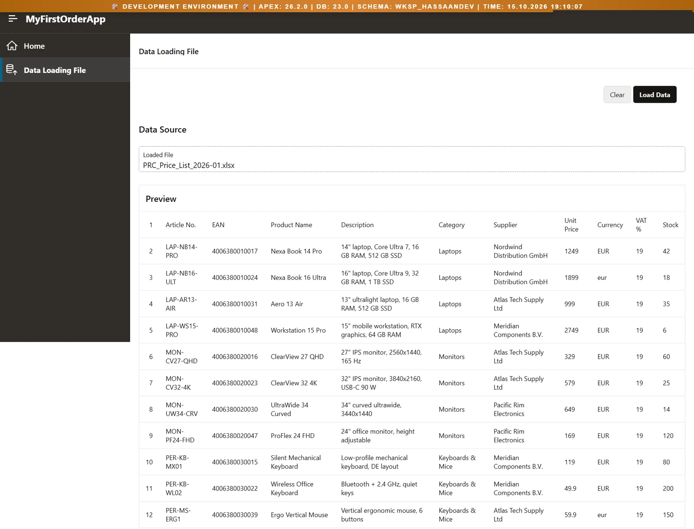
</p>

**By Hassaan Ahmed Tahir — Senior Oracle APEX Developer · [Read the full tutorial](https://apexwithhassaan.vercel.app/blog/data-load-definitions)**

---

## 📁 Repository structure

```
apex-data-load-definitions/
src/01_create_tables.sql                # PRC_CATEGORIES, PRC_SUPPLIERS and PRC_PRODUCTS
src/02_seed_categories_suppliers.sql    # lookup data for categories and suppliers
src/03_products_trigger.sql             # first version of the products trigger
src/04_fixes_after_test_1.sql           # improved trigger + wider currency column (see Test 1)
samples/PRC_Price_List_2026-01.xlsx     # January price list (24 rows)
samples/PRC_Price_List_2026-02.xlsx     # February price list (22 rows, 8 traps)
docs/images/                            # screenshots from the blog post
CHANGELOG.md
LICENSE                                 # MIT
README.md
```

> 💡 Every file above contains the exact code from the tutorial below, ready to copy or run.

---

Sooner or later every business application gets the same request: *"Can users just upload our Excel price list?"* And Excel files are never clean. Category names arrive as text instead of IDs, someone types `eur` in lowercase, a supplier sends a negative price, and next month's file contains a mix of changed products, brand-new products and a few plain mistakes.

Most developers answer with a custom PL/SQL import script — parse the file, validate every column, decide insert-or-update, collect the bad rows. It works, but you rebuild it for every import in every project. **Data Load Definitions** in Oracle APEX do all of that declaratively, from **Shared Components**, with a ready-made upload page on top.

In this post I build a realistic **Product Price List Import** end to end — three related tables, two Excel files, foreign-key lookups, merge (upsert) loading and per-row error reporting — and I show you exactly where it breaks and how to fix it, because that is where the real learning is.

> ✅ **What you'll have at the end:** an upload page where a user drops in an `.xlsx` price list and APEX **inserts new products, updates existing ones, resolves category and supplier names to IDs, and lists every rejected row with the exact reason** — without a single line of import code in the page.

> 🧪 **Tested on:** Oracle APEX 26.2 with Oracle Database 23.0. Data Load Definitions live in Shared Components in earlier APEX releases too; menu labels can differ slightly between versions.

## 📑 Table of Contents

1. [What Is a Data Load Definition (and Why Use One)?](#what-is)
2. [How It Works: From Excel File to Database Rows](#how-it-works)
3. [The Demo Scenario: Two Files, Two Jobs](#scenario)
4. [Step 1: Create the Demo Tables](#step-1)
5. [Step 2: Look at the Two Excel Files](#step-2)
6. [Step 3: Create the Data Load Definition](#step-3)
7. [Step 4: Choose the Loading Method and Error Handling](#step-4)
8. [Step 5: Build the Data Profile](#step-5)
9. [Step 6: Resolve Foreign Keys with Lookup Columns](#step-6)
10. [Step 7: The Data Loading Page](#step-7)
11. [Test 1: Load the January File (and Why It Failed at First)](#test-1)
12. [Test 2: Load the February File — Update, Insert and Reject](#test-2)
13. [Gotchas That Cost Me Time](#gotchas)
14. [Production Checklist](#checklist)
15. [Wrap-Up and What's Next](#wrap-up)

<a id="what-is"></a>

## 1. What Is a Data Load Definition (and Why Use One)?

A **Data Load Definition** is a reusable description of how to turn an uploaded file into rows in a table. You define it once in **Shared Components → Data Load Definitions**, and any page in the application can use it. It is made of three parts:

| Part | What it describes |
|---|---|
| **Data Load Definition** | The *target* (a table), the **loading method** (Append, Merge or Replace) and what to do when a row fails. |
| **Data Profile** | The *shape of the file* — format (XLSX, CSV, XML or JSON), whether the first line holds headers, and the list of columns. |
| **Data Profile Columns** | How *one column* is read: which header it comes from, its data type and format mask, whether it is a primary key, or whether its value is looked up from another table. |

Compare that with the usual alternatives:

|  | Custom PL/SQL import script | Data Load Definition |
|---|---|---|
| Parsing XLSX / CSV | You write or wire up a parser | Built in |
| Insert-or-update logic | Hand-written `MERGE` or loops | One setting: **Merge** + a primary key column |
| Text → ID (category, supplier…) | Extra joins or lookups in your code | A **Lookup** column, configured in the UI |
| Bad rows | Your exception handling and logging | **Log Error into Collection** — shown in the page for you |
| Upload page | Build it yourself | Generated by the wizard |
| Reuse | Copy and adapt the script | Same definition, any page |

The result is far less code to write and maintain — and the same behaviour for every import you add later.

<a id="how-it-works"></a>

## 2. How It Works: From Excel File to Database Rows

Here is the journey of one uploaded file:

1. 📄 **Excel file** — Uploaded on the Data Loading page
2. 🧩 **Data Profile** — Reads each column, converts types, runs lookups
3. 🔀 **Merge** — Row exists? update it. Otherwise insert it
4. 🗄️ **Table + Error list** — Good rows saved, bad rows reported with the reason

Three loading methods decide what happens to rows that match existing data:

| Method | Behaviour | Needs a primary key column? |
|---|---|---|
| **Append** | Adds rows. If a primary key is defined, existing rows are left unchanged. | Optional |
| **Merge** | Updates the row if the key exists, inserts it if not — an **upsert**. Tables only. | **Yes** |
| **Replace** | Deletes the existing data first, then loads the file. | No |

And **When on Error** decides what a failed row does to the rest of the load:

| Option | What happens |
|---|---|
| **Ignore** | Bad rows are silently skipped and loading continues. |
| **Stop** | Loading stops at the first error and shows a message. |
| **Log Error into Collection** | Bad rows are stored in an APEX collection — the generated page lists them with the Oracle error. |
| **Log into Error Log** | Bad rows go to a DML error-logging table. Only available with *Append* and no primary key. |

> ⚠️ **Notice the catch:** *Log into Error Log* cannot be combined with *Merge* and a primary key. Since upsert is exactly what we want, this demo uses **Log Error into Collection**.

<a id="scenario"></a>

## 3. The Demo Scenario: Two Files, Two Jobs

Imagine you maintain the product catalog for a small IT-hardware distributor. Every month, the purchasing team sends an updated price list as an Excel sheet. You need those prices in the `PRC_PRODUCTS` table. Two files tell the whole story:

|  | 📄 January file | 📄 February file |
|---|---|---|
| **Role** | The starting catalog — "Day 1" | The next monthly update — everyday reality |
| **Rows** | 24 | 22 |
| **Content** | 24 brand-new products | **8** price/stock updates, **6** new products and **8** deliberately broken rows |
| **What it proves** | Reading columns, resolving category and supplier names to IDs, cleaning messy text | **Merge** (upsert) and **error isolation** — bad rows are rejected, good rows still load |

The data lives in three tables: `PRC_CATEGORIES` and `PRC_SUPPLIERS` (small reference tables) and `PRC_PRODUCTS`, which references both through foreign keys. The Excel file has no IDs — only the *names* "Laptops" and "Nordwind Distribution GmbH" — so the load must translate names into IDs. That translation is the job of a **Lookup** column.

<a id="step-1"></a>

## 4. Step 1: Create the Demo Tables

Run this in **SQL Workshop → SQL Commands**. Constraints matter here: they are what protects the table when a bad row arrives, and they produce the precise error messages you'll see later.

```sql
CREATE TABLE prc_categories (
  cate_id        NUMBER GENERATED BY DEFAULT AS IDENTITY,
  cate_code      VARCHAR2(30)  NOT NULL,
  cate_name      VARCHAR2(100) NOT NULL,
  cate_active_yn VARCHAR2(3)   DEFAULT 'YES' NOT NULL,
  cate_created   TIMESTAMP     DEFAULT SYSTIMESTAMP NOT NULL,
  CONSTRAINT prc_categories_pk      PRIMARY KEY (cate_id),
  CONSTRAINT prc_categories_code_uk UNIQUE (cate_code),
  CONSTRAINT prc_categories_name_uk UNIQUE (cate_name),
  CONSTRAINT prc_categories_act_ck  CHECK (cate_active_yn IN ('YES','NO'))
);

CREATE TABLE prc_suppliers (
  supp_id        NUMBER GENERATED BY DEFAULT AS IDENTITY,
  supp_code      VARCHAR2(30)  NOT NULL,
  supp_name      VARCHAR2(200) NOT NULL,
  supp_country   VARCHAR2(2),
  supp_email     VARCHAR2(200),
  supp_active_yn VARCHAR2(3)   DEFAULT 'YES' NOT NULL,
  supp_created   TIMESTAMP     DEFAULT SYSTIMESTAMP NOT NULL,
  CONSTRAINT prc_suppliers_pk      PRIMARY KEY (supp_id),
  CONSTRAINT prc_suppliers_code_uk UNIQUE (supp_code),
  CONSTRAINT prc_suppliers_name_uk UNIQUE (supp_name),
  CONSTRAINT prc_suppliers_act_ck  CHECK (supp_active_yn IN ('YES','NO'))
);
```

```sql
CREATE TABLE prc_products (
  prod_id          NUMBER GENERATED BY DEFAULT AS IDENTITY,
  prod_sku         VARCHAR2(40)  NOT NULL,
  prod_ean         VARCHAR2(13),
  prod_name        VARCHAR2(200) NOT NULL,
  prod_description VARCHAR2(4000),
  prod_cate_fk     NUMBER        NOT NULL,
  prod_supp_fk     NUMBER        NOT NULL,
  prod_unit_price  NUMBER(12,2)  NOT NULL,
  prod_currency    VARCHAR2(3)   DEFAULT 'EUR' NOT NULL,
  prod_vat_rate    NUMBER(5,2)   DEFAULT 19,
  prod_stock_qty   NUMBER(10)    DEFAULT 0,
  prod_status      VARCHAR2(20)  DEFAULT 'ACTIVE' NOT NULL,
  prod_launch_date DATE,
  prod_created     TIMESTAMP     DEFAULT SYSTIMESTAMP NOT NULL,
  prod_created_by  VARCHAR2(4000)
                   DEFAULT COALESCE(SYS_CONTEXT('apex$session','app_user'),
                                    SYS_CONTEXT('userenv','session_user')) NOT NULL,
  prod_updated     TIMESTAMP,
  prod_updated_by  VARCHAR2(4000),
  CONSTRAINT prc_products_pk        PRIMARY KEY (prod_id),
  CONSTRAINT prc_products_sku_uk    UNIQUE (prod_sku),
  CONSTRAINT prc_products_cate_fk   FOREIGN KEY (prod_cate_fk) REFERENCES prc_categories (cate_id),
  CONSTRAINT prc_products_supp_fk   FOREIGN KEY (prod_supp_fk) REFERENCES prc_suppliers (supp_id),
  CONSTRAINT prc_products_price_ck  CHECK (prod_unit_price >= 0),
  CONSTRAINT prc_products_curr_ck   CHECK (prod_currency IN ('EUR','USD','GBP')),
  CONSTRAINT prc_products_vat_ck    CHECK (prod_vat_rate BETWEEN 0 AND 30),
  CONSTRAINT prc_products_stock_ck  CHECK (prod_stock_qty >= 0),
  CONSTRAINT prc_products_status_ck CHECK (prod_status IN ('ACTIVE','INACTIVE','DISCONTINUED')),
  CONSTRAINT prc_products_ean_ck    CHECK (REGEXP_LIKE(prod_ean, '^[0-9]{8}$|^[0-9]{13}$'))
);

CREATE INDEX prc_products_cate_ix ON prc_products (prod_cate_fk);
CREATE INDEX prc_products_supp_ix ON prc_products (prod_supp_fk);
```

```sql
-- In SQL Developer or SQL*Plus run SET DEFINE OFF first (the & in "Keyboards & Mice")
INSERT INTO prc_categories (cate_code, cate_name) VALUES ('LAP', 'Laptops');
INSERT INTO prc_categories (cate_code, cate_name) VALUES ('MON', 'Monitors');
INSERT INTO prc_categories (cate_code, cate_name) VALUES ('PER', 'Keyboards & Mice');
INSERT INTO prc_categories (cate_code, cate_name) VALUES ('NET', 'Networking');
INSERT INTO prc_categories (cate_code, cate_name) VALUES ('STO', 'Storage');
INSERT INTO prc_categories (cate_code, cate_name) VALUES ('ACC', 'Accessories');

INSERT INTO prc_suppliers (supp_code, supp_name, supp_country, supp_email)
VALUES ('NORDWIND', 'Nordwind Distribution GmbH', 'DE', 'orders@nordwind.example');
INSERT INTO prc_suppliers (supp_code, supp_name, supp_country, supp_email)
VALUES ('ATLAS', 'Atlas Tech Supply Ltd', 'GB', 'sales@atlas-tech.example');
INSERT INTO prc_suppliers (supp_code, supp_name, supp_country, supp_email)
VALUES ('MERIDIAN', 'Meridian Components B.V.', 'NL', 'sales@meridian.example');
INSERT INTO prc_suppliers (supp_code, supp_name, supp_country, supp_email)
VALUES ('PACRIM', 'Pacific Rim Electronics', 'SG', 'orders@pacrim.example');

COMMIT;
```

```sql
CREATE OR REPLACE TRIGGER prc_products_bu
BEFORE UPDATE ON prc_products
FOR EACH ROW
BEGIN
  :NEW.prod_updated    := SYSTIMESTAMP;
  :NEW.prod_updated_by := COALESCE(SYS_CONTEXT('apex$session','app_user'),
                                   SYS_CONTEXT('userenv','session_user'));
END;
/
```

Check that everything exists:

```sql
SELECT 'Categories' tbl, COUNT(*) cnt FROM prc_categories
UNION ALL SELECT 'Suppliers', COUNT(*) FROM prc_suppliers
UNION ALL SELECT 'Products',  COUNT(*) FROM prc_products;
```

<p align="center">
  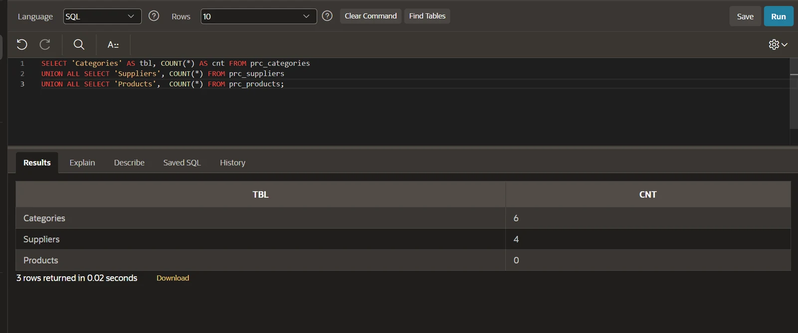<br>
  <em>Figure 1 · SQL Commands — table row counts. Six categories, four suppliers and an empty products table — ready to be filled by the import.</em>
</p>

<a id="step-2"></a>

## 5. Step 2: Look at the Two Excel Files

Both files use the same 12 columns: `Article No.`, `EAN`, `Product Name`, `Description`, `Category`, `Supplier`, `Unit Price`, `Currency`, `VAT %`, `Stock`, `Status` and `Launch Date`. The EAN column is formatted as text and the launch date as `yyyy-mm-dd`.

**⬇️ Download the sample files** and follow along with the same data:

- 📥 [`PRC_Price_List_2026-01.xlsx`](samples/PRC_Price_List_2026-01.xlsx) — January: the starting catalog (24 rows · 8 KB)
- 📥 [`PRC_Price_List_2026-02.xlsx`](samples/PRC_Price_List_2026-02.xlsx) — February: updates, new products and 8 traps (22 rows · 8 KB)

### January — realistic, slightly messy

Look closely at the highlighted cells. Real files contain stray spaces and inconsistent casing, and a load has to cope with them:

| Article No. | Product Name | Category | Supplier | Unit Price | Currency | Status |
|---|---|---|---|---|---|---|
| LAP-NB14-PRO | Nexa Book 14 Pro | Laptops | Nordwind Distribution GmbH | 1249 | EUR | `␣Active␣` |
| LAP-NB16-ULT | Nexa Book 16 Ultra | Laptops | Nordwind Distribution GmbH | 1899 | `eur` | Active |
| LAP-AR13-AIR | Aero 13 Air | Laptops | Atlas Tech Supply Ltd | 999 | EUR | ACTIVE |
| LAP-WS15-PRO | Workstation 15 Pro | Laptops | Meridian Components B.V. | 2749 | EUR | `active` |
| MON-CV32-4K | ClearView 32 4K | Monitors | Atlas Tech Supply Ltd | 579 | `␣EUR` | Active |
| … | … | … | … | … | … | … |
| ACC-BAG-15 | Business Laptop Backpack 15" | Accessories | Nordwind Distribution GmbH | 69 | EUR | `␣active` |

(`␣` marks a leading or trailing space.)

### February — updates, new products and eight traps

The February file mixes three kinds of rows. The last group is deliberately broken — each row violates a different rule:

| Group | Rows | Examples |
|---|---|---|
| **UPDATE** Existing SKUs | 8 | `LAP-NB14-PRO` price 1249 → 1199, stock 42 → 55 · `MON-PF24-FHD` becomes *Discontinued* |
| **INSERT** New SKUs | 6 | `LAP-NB14-G2`, `MON-CV27-OLED`, `NET-RT-BE7` (currency `usd`), `ACC-CHG-140` (GBP, VAT 20) … |
| **REJECT** Broken rows | 8 | Unknown category, unknown supplier, negative price, currency `CHF`, EAN `12345`, missing name, VAT 45, status `Clearance` |

<a id="step-3"></a>

## 6. Step 3: Create the Data Load Definition

Go to **Shared Components → Data Sources → Data Load Definitions** (the exact grouping can vary by version) and click **Create**. The wizard walks you through naming the definition, choosing the target table, and uploading a **sample file** so APEX can read the headers and guess each column's data type. Use the January file.

The last step is **Map Columns**. APEX lists every source column with its detected type, lets you map it to a table column, and lets you mark the **Primary Key**. You can finish here — *Create Data Load* creates just the definition, *Create and Add Page* also generates the upload page. We'll fine-tune everything afterwards, so don't worry about getting it perfect.

<p align="center">
  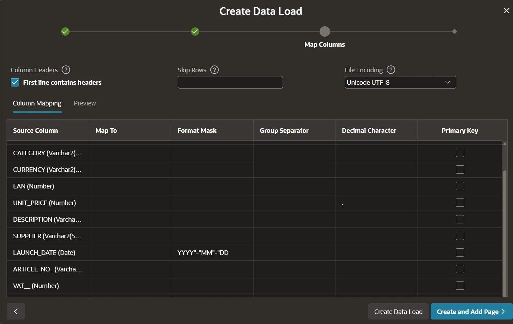<br>
  <em>Figure 2 · Create Data Load — Map Columns. The wizard reads the sample file and shows each source column with its detected type. Note how LAUNCH_DATE already carries a format mask.</em>
</p>

> 💡 **Check the detected types.** The wizard guessed `EAN` as a **Number**. Barcodes are identifiers, not quantities — as a number you would lose leading zeros — so I changed that column to **Varchar2** in the Data Profile.

Notice how APEX turned the Excel headers into **selector names**: `Article No.` became `ARTICLE_NO_` and `VAT %` became `VAT__`. Spaces and special characters turn into underscores. You'll type these selectors when you adjust columns.

<p align="center">
  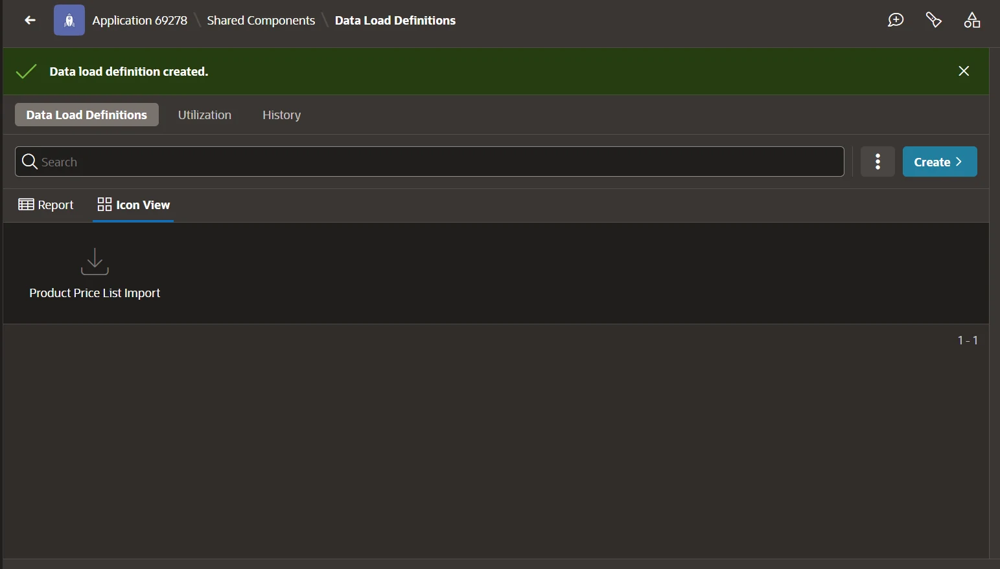<br>
  <em>Figure 3 · Data Load Definitions in Shared Components. The new definition, Product Price List Import, listed in Shared Components.</em>
</p>

<a id="step-4"></a>

## 7. Step 4: Choose the Loading Method and Error Handling

Open the definition. On the main page you'll find **Target**, **Settings** and **Error Handling**. These are the values for our import:

| Section | Setting | Value | Why |
|---|---|---|---|
| Target | Target Type | `Table` | We load into a table (the other option is a collection) |
| Target | Table Name | `PRC_PRODUCTS` | The destination |
| Settings | Loading Method | `Merge` | Update existing SKUs, insert new ones |
| Settings | Commit Interval | `200` (default) | Commit every 200 rows |
| Error Handling | When on Error | `Log Error into Collection` | Collect bad rows, keep loading good ones |
| Error Handling | Error Collection Name | `PRC_PRODUCTS_LOAD_ERRORS` | Required for this option |
| Advanced | Static ID | `product-price-list-import` | A stable name to reference the definition |

<p align="center">
  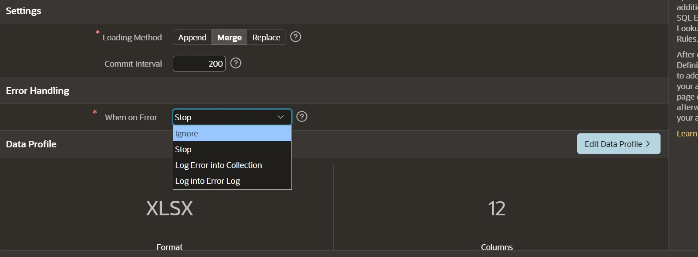<br>
  <em>Figure 4 · When on Error — the four options. Choosing Log Error into Collection is what lets the page list rejected rows instead of failing the whole file.</em>
</p>

<p align="center">
  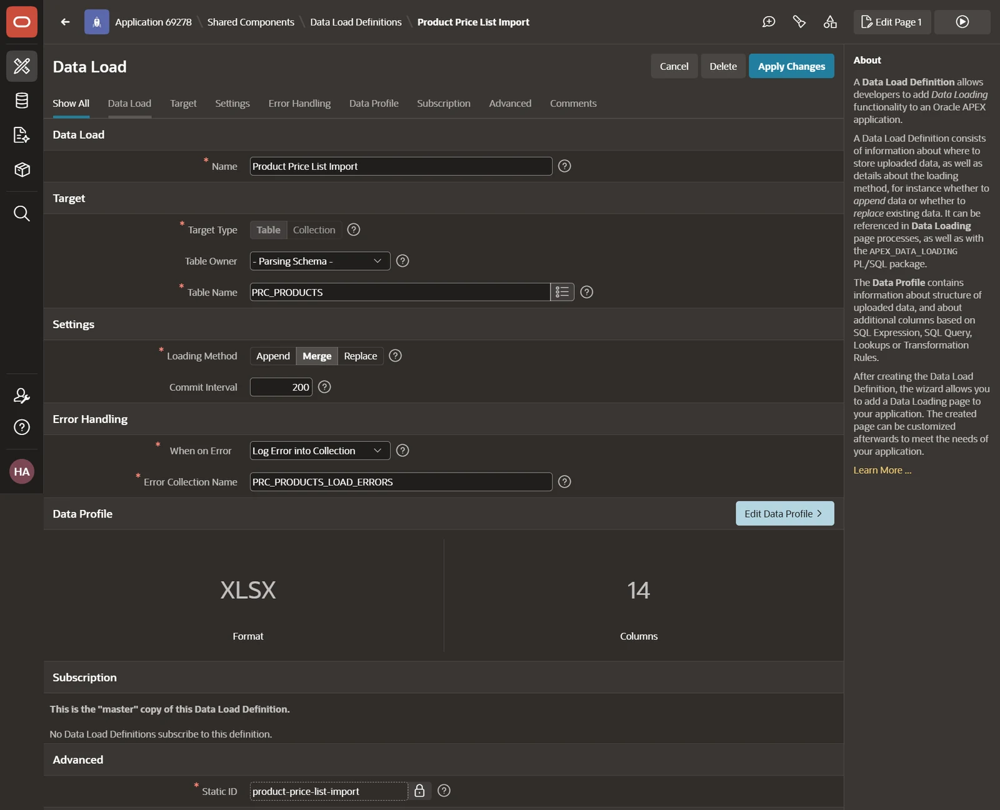<br>
  <em>Figure 5 · Data Load Definition — Target, Settings and Error Handling. The finished definition: table PRC_PRODUCTS, Merge, errors logged into a collection.</em>
</p>

> ⚠️ **If you pick *Log into Error Log* with Merge** APEX refuses with: *"Log into Error Log not supported for Merge loading method nor Append loading method if a primary key column defined."* Switch to **Log Error into Collection** and enter a collection name — leaving the name empty gives a second error, *"Error Collection Name must be specified"*.

<a id="step-5"></a>

## 8. Step 5: Build the Data Profile

Click **Edit Data Profile**. The profile holds one entry per column. Here is the final layout — **14 columns** for a 12-column file, because the two lookups need helper columns (Step 6):

| # | Profile column | Type | Data type | Selector (Excel header) | Notes |
|---|---|---|---|---|---|
| 1 | `PROD_SKU` | Data | Varchar2 | `ARTICLE_NO_` | **Primary Key = Yes** — Merge matches rows on this |
| 2 | `PROD_EAN` | Data | Varchar2 | `EAN` | Text, not number |
| 3 | `PROD_NAME` | Data | Varchar2 | `PRODUCT_NAME` |  |
| 4 | `PROD_DESCRIPTION` | Data | Varchar2 | `DESCRIPTION` |  |
| 5 | `CATEGORY_RAW` | Data | Varchar2 | `CATEGORY` | Helper — the text "Laptops" |
| 6 | `PROD_CATE_FK` | **Lookup** | Number | — | Text → `CATE_ID` (Step 6) |
| 7 | `SUPPLIER_RAW` | Data | Varchar2 | `SUPPLIER` | Helper — the supplier name |
| 8 | `PROD_SUPP_FK` | **Lookup** | Number | — | Name → `SUPP_ID` (Step 6) |
| 9 | `PROD_UNIT_PRICE` | Data | Number | `UNIT_PRICE` |  |
| 10 | `PROD_CURRENCY` | Data | Varchar2 | `CURRENCY` |  |
| 11 | `PROD_VAT_RATE` | Data | Number | `VAT__` |  |
| 12 | `PROD_STOCK_QTY` | Data | Number | `STOCK` |  |
| 13 | `PROD_STATUS` | Data | Varchar2 | `STATUS` |  |
| 14 | `PROD_LAUNCH_DATE` | Data | Date | `LAUNCH_DATE` | Format mask `YYYY"-"MM"-"DD` |

> ℹ️ **How mapping works:** a profile column's **Name** is matched to the target table column with the same name. That is why `PROD_SKU`, `PROD_NAME` and the rest line up with `PRC_PRODUCTS` automatically. `CATEGORY_RAW` and `SUPPLIER_RAW` match no table column, so APEX simply doesn't write them — they exist only to feed the lookups.

<p align="center">
  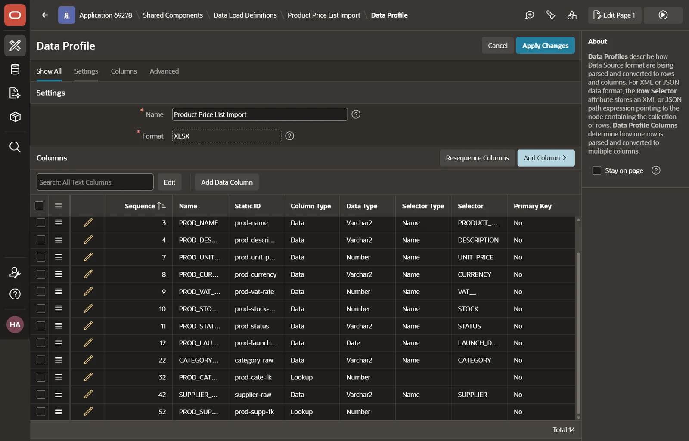<br>
  <em>Figure 6 · Data Profile — all 14 columns. The final Data Profile (Total 14), scrolled to show the two Lookup columns and their _RAW helper columns.</em>
</p>

> 💡 **Column Type is chosen when you create a column** and cannot be changed afterwards. If you create a column as *Data* and later need a *Lookup*, delete it and add it again with the right type.

Besides *Data* and *Lookup*, a profile column can also be a **SQL Expression** or **SQL Query**, and every Data column has a **Value Transformation** setting for simple clean-up. We'll meet both in Test 1.

<a id="step-6"></a>

## 9. Step 6: Resolve Foreign Keys with Lookup Columns

The Excel file says `Laptops`; the table needs `PROD_CATE_FK = 1`. A **Lookup column** performs exactly that translation: it takes a value from the file, finds the matching row in another table, and returns a different column of that row.

A Lookup needs a **source value**, and that value comes from another profile column. So the pattern is always **two columns**:

1. A plain **Data** column that reads the raw text — `CATEGORY_RAW` with selector `CATEGORY`.
2. A **Lookup** column named like the table column — `PROD_CATE_FK` — that uses it.

| Lookup attribute | PROD_CATE_FK | PROD_SUPP_FK |
|---|---|---|
| Column Type | Lookup | Lookup |
| Data Type | Number | Number |
| Table Name | `PRC_CATEGORIES` | `PRC_SUPPLIERS` |
| Return Column | `CATE_ID` | `SUPP_ID` |
| Table Column 1 | `CATE_NAME` | `SUPP_NAME` |
| Data Column 1 | `CATEGORY_RAW` | `SUPPLIER_RAW` |

Read it like a sentence: *"Find the row in `PRC_CATEGORIES` where `CATE_NAME` equals the value of `CATEGORY_RAW`, and give me its `CATE_ID`."*

<p align="center">
  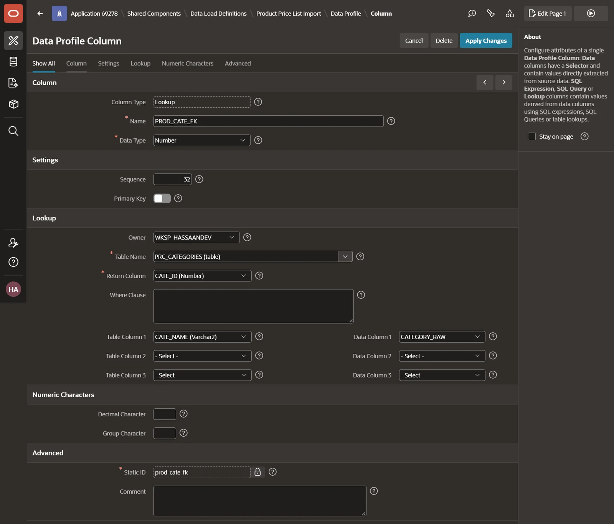<br>
  <em>Figure 7 · Lookup column — PROD_CATE_FK. The lookup that turns the category name from the file into a category ID.</em>
</p>

> ⚠️ **What if nothing matches?** The lookup returns `NULL`. In our table `PROD_CATE_FK` and `PROD_SUPP_FK` are `NOT NULL`, so the row is rejected with `ORA-01400` — exactly what we want. If your foreign key column were nullable, an unknown category would **silently load as NULL**. Keep lookup targets `NOT NULL` when a match is mandatory.

<a id="step-7"></a>

## 10. Step 7: The Data Loading Page

The definition is a Shared Component; users need a page to upload files. If you chose *Create and Add Page* in the wizard you already have one. Otherwise use **Create Page → Data Loading** and select the **Product Price List Import** definition. APEX generates a complete page with an upload step, a preview and a results area:

- a **File Browse** item (`P2_FILE`) and a worksheet-name item for Excel;
- **Clear** and **Load Data** buttons;
- a **Preview** of the parsed file and an **Errors** region;
- dynamic actions that submit the page when a file is chosen;
- a page process of type **Data Loading** that does the real work.

<p align="center">
  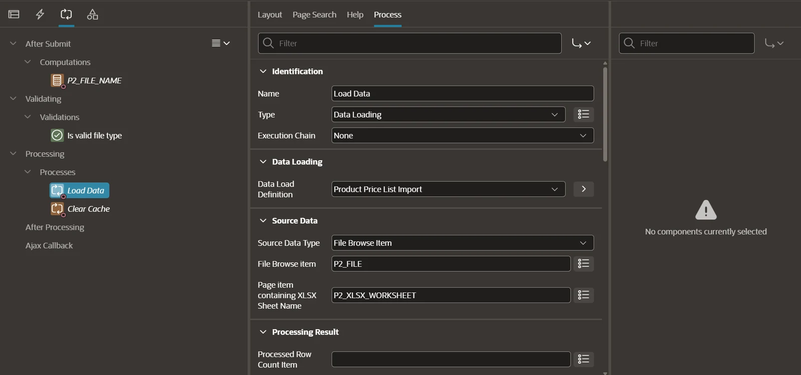<br>
  <em>Figure 8 · Page Designer — the Load Data process. The generated process is type Data Loading; it points at Product Price List Import and reads the uploaded file from P2_FILE.</em>
</p>

That process is the whole "import engine" — you wrote no PL/SQL for it. Run the page: you'll see an upload area; choose a file and APEX shows a preview of what it parsed.

<p align="center">
  <br>
  <em>Figure 9 · Data Loading page — preview of the January file. After choosing the file, the page previews the parsed rows — note the raw eur values in rows 3 and 12. Nothing is saved until you click Load Data.</em>
</p>

<a id="test-1"></a>

## 11. Test 1: Load the January File (and Why It Failed at First)

Upload `PRC_Price_List_2026-01.xlsx` and click **Load Data**. My first attempt did **not** go well:

<p align="center">
  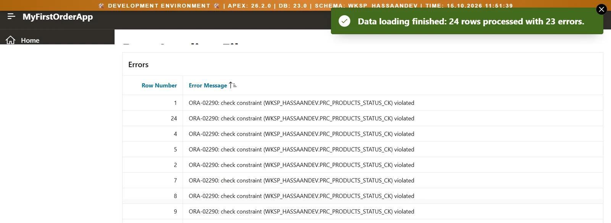<br>
  <em>Figure 10 · First attempt — 23 errors. 24 rows processed with 23 errors. Almost every row failed with ORA-02290 on PRC_PRODUCTS_STATUS_CK.</em>
</p>

APEX has a built-in place for simple cleaning: every Data column has a **Value Transformation** setting (in the column's *Source* section). It offers Trim, Left/Right Trim, To Upper Case, To Lower Case, Replace, Null If and their regular-expression versions:

<p align="center">
  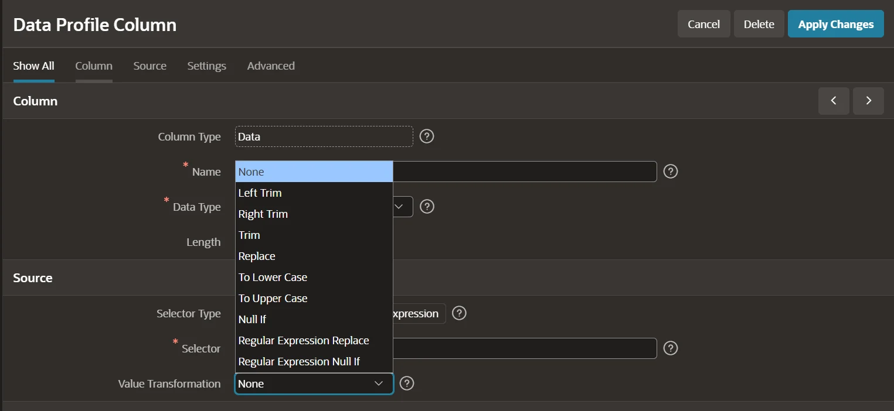<br>
  <em>Figure 11 · Value Transformation — built-in options. The Value Transformation list on a Data column. One transformation is chosen per column.</em>
</p>

If a column only needs *one* fix — just trimming, or just upper-casing — this is the zero-code answer and you should use it. Our `Status` and `Currency` columns need **both** (`␣Active␣` must be trimmed *and* upper-cased), and the list takes one option per column.

The profile was fine — the *data* wasn't. The check constraint accepts only `ACTIVE`, `INACTIVE` and `DISCONTINUED`, but the file contained `Active`, `active` and `␣Active␣`. Only one of the 24 rows (`LAP-AR13-AIR`, already upper case) matched exactly. The file's messy currency values would have been the next problem.

So I normalise these two columns in a **row-level trigger** instead. It fires for every insert and update — from this import, from an APEX form, from an API — so the rule can never be bypassed.

```sql
DROP TRIGGER prc_products_bu;

CREATE OR REPLACE TRIGGER prc_products_biu
BEFORE INSERT OR UPDATE ON prc_products
FOR EACH ROW
BEGIN
  -- normalise text that arrives with odd casing or spaces
  :NEW.prod_status   := UPPER(TRIM(:NEW.prod_status));
  :NEW.prod_currency := REGEXP_REPLACE(UPPER(:NEW.prod_currency), '[^A-Z]', '');

  IF UPDATING THEN
    :NEW.prod_updated    := SYSTIMESTAMP;
    :NEW.prod_updated_by := COALESCE(SYS_CONTEXT('apex$session','app_user'),
                                     SYS_CONTEXT('userenv','session_user'));
  END IF;
END;
/
```

`UPPER(TRIM(...))` handles the status. For the currency I strip **everything that isn't a letter** — a currency code never contains anything else, so this also removes tabs, line breaks and non-breaking spaces that `TRIM` would leave behind.

Reloading cleared 23 errors down to **one** — and it was a different error:

<p align="center">
  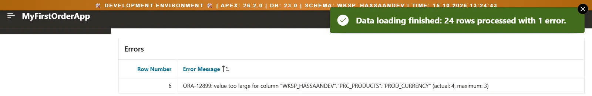<br>
  <em>Figure 12 · Second attempt — one remaining error. ORA-12899: value too large for column PROD_CURRENCY (actual: 4, maximum: 3) — the row with ␣EUR.</em>
</p>

That is odd: the trigger would turn `␣EUR` into `EUR`, three characters. But in my test the length check fired **even with the trigger in place** — the raw four-character value is evidently rejected during the load before the row trigger can shorten it. The fix is to give the column headroom and let the trigger plus the check constraint do the real policing:

```sql
ALTER TABLE prc_products MODIFY (prod_currency VARCHAR2(10));
```

The `PRC_PRODUCTS_CURR_CK` constraint still guarantees that only `EUR`, `USD` and `GBP` can ever be *stored*, so widening the column loosens nothing. Clear the table and load January again:

```sql
DELETE FROM prc_products;
COMMIT;
```

<p align="center">
  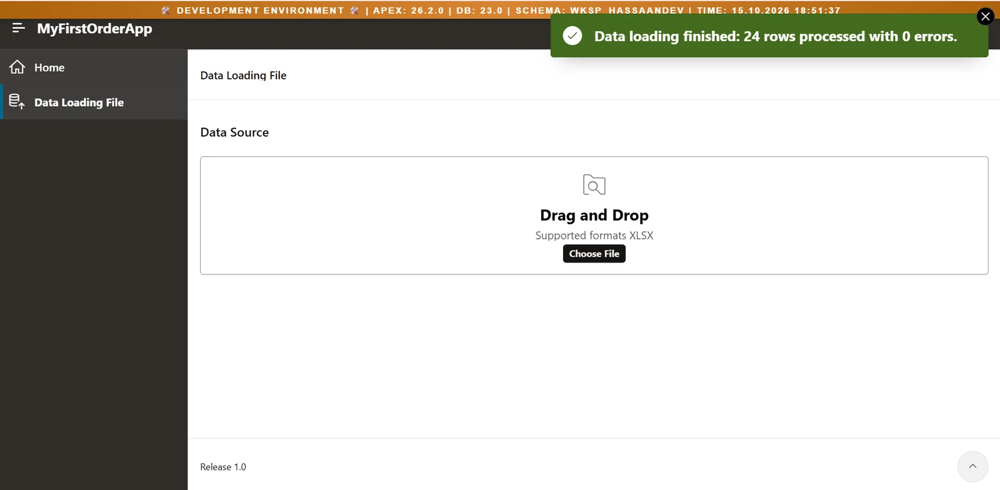<br>
  <em>Figure 13 · Load result — January. Data loading finished: 24 rows processed with 0 errors.</em>
</p>

Verify the data. Every product is there, both foreign keys resolved to real IDs, and the messy values are now clean:

```sql
SELECT prod_sku, prod_name, prod_cate_fk, prod_supp_fk,
       prod_unit_price, prod_currency, prod_status
FROM   prc_products
ORDER  BY prod_sku;
```

| Article No. | In the Excel file | Stored in the table |
|---|---|---|
| LAP-NB14-PRO | Status `␣Active␣` | `ACTIVE` |
| LAP-NB16-ULT | Currency `eur` | `EUR` |
| LAP-WS15-PRO | Status `active` | `ACTIVE` |
| MON-CV32-4K | Currency `␣EUR` | `EUR` |
| PER-MS-ERG1 | Currency `eur` | `EUR` |
| ACC-BAG-15 | Status `␣active` | `ACTIVE` |
| all 24 rows | Category and supplier as *text* | `PROD_CATE_FK` and `PROD_SUPP_FK` hold numeric IDs |

> ✅ **January proves the pipeline:** 24 rows read, 24 lookups resolved, messy text cleaned, 24 products inserted.

<a id="test-2"></a>

## 12. Test 2: Load the February File — Update, Insert and Reject

Now the real test. **Clear** the page, upload `PRC_Price_List_2026-02.xlsx` and click **Load Data**. The Merge method compares each row's `PROD_SKU` with what's already in the table.

<p align="center">
  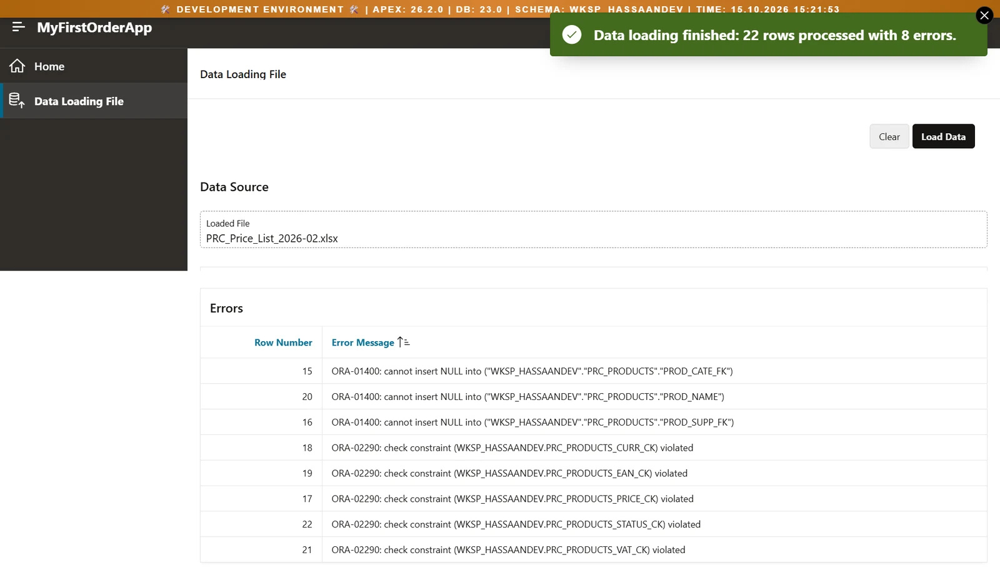<br>
  <em>Figure 14 · Load result — February. 22 rows processed with 8 errors. The 14 good rows were saved; the 8 bad rows are listed with the exact Oracle error.</em>
</p>

The 8 rejections map one-to-one to the traps in the file. The **Row Number** counts data rows, starting with 1 after the header:

| Row | Article No. | What was wrong | Oracle error |
|---|---|---|---|
| 15 | `TAB-NX11-WIFI` | Category `Tablets` doesn't exist → lookup returns NULL | `ORA-01400` cannot insert NULL into `PROD_CATE_FK` |
| 16 | `ACC-PWR-20K` | Supplier `Unknown Traders Ltd` doesn't exist | `ORA-01400` cannot insert NULL into `PROD_SUPP_FK` |
| 17 | `PER-KB-GAM1` | Negative price (−89) | `ORA-02290` `PRC_PRODUCTS_PRICE_CK` |
| 18 | `MON-PF22-FHD` | Currency `CHF` is not allowed | `ORA-02290` `PRC_PRODUCTS_CURR_CK` |
| 19 | `NET-CB-C6A10` | EAN `12345` is not 8 or 13 digits | `ORA-02290` `PRC_PRODUCTS_EAN_CK` |
| 20 | `STO-USB-256` | Product name is empty | `ORA-01400` cannot insert NULL into `PROD_NAME` |
| 21 | `ACC-HUB-7P` | VAT 45 is outside 0–30 | `ORA-02290` `PRC_PRODUCTS_VAT_CK` |
| 22 | `LAP-AR13-AIR` | Status `Clearance` is not allowed (an update attempt) | `ORA-02290` `PRC_PRODUCTS_STATUS_CK` |

Now confirm that Merge did what it promised — updates applied, new rows inserted, and the **rejected update left the existing row untouched**:

```sql
SELECT COUNT(*) AS total_products FROM prc_products;   -- 24 + 6 new = 30

SELECT prod_sku, prod_unit_price, prod_stock_qty, prod_status
FROM   prc_products
WHERE  prod_sku IN ('LAP-NB14-PRO','LAP-AR13-AIR','LAP-NB14-G2','PER-MS-TRV')
ORDER  BY prod_sku;
```

<p align="center">
  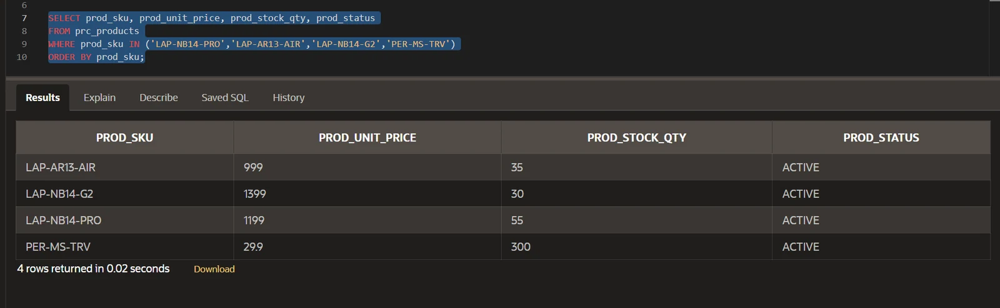<br>
  <em>Figure 15 · SQL Commands — verifying the merge. Four SKUs, four different outcomes.</em>
</p>

| Article No. | February row | Result | Stored values |
|---|---|---|---|
| `LAP-NB14-PRO` | Price 1199, stock 55 | **UPDATED** | 1199 · 55 · ACTIVE |
| `LAP-NB14-G2` | New product | **INSERTED** | 1399 · 30 · ACTIVE |
| `PER-MS-TRV` | New product | **INSERTED** | 29.9 · 300 · ACTIVE |
| `LAP-AR13-AIR` | Price 949, status `Clearance` | **REJECTED** | **999 · 35 · ACTIVE** — unchanged |

> ✅ **The key result:** a failed row changes *nothing*. `LAP-AR13-AIR` kept its old price of 999 because its whole update was rejected — no half-applied changes. And the 8 failures did not stop the 14 good rows from loading.

<a id="gotchas"></a>

## 13. Gotchas That Cost Me Time

These are the problems I actually hit while building this — each one will save you time.

### 1. A lookup needs a helper column — and the column type can't be changed later

My first try read the category text straight into a `Number` column. A Lookup column has no source of its own; it must point at another profile column via **Data Column 1**. Create the raw Data column first, then the Lookup. Because **Column Type is fixed at creation**, a wrongly typed column has to be deleted and re-created.

### 2. A SQL Expression column could not read a sibling column (in my test)

My first idea for cleaning text was a second profile column of type **SQL Expression** built on the raw column, like the lookups: `UPPER(TRIM(:STATUS_RAW))`. It saved without complaint — but every row then failed at load time:

<p align="center">
  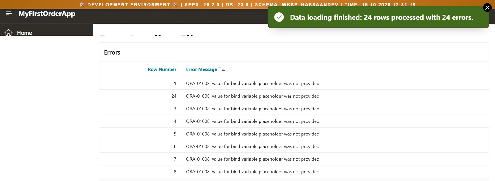<br>
  <em>Figure 16 · SQL Expression with :STATUS_RAW — every row fails. 24 rows processed with 24 errors, all ORA-01008: value for bind variable placeholder was not provided.</em>
</p>

The expression was being run as plain SQL with an unbound `:STATUS_RAW` placeholder. Switching to the `#STATUS_RAW#` substitution style didn't help — APEX validated the field as real SQL and rejected the `#` immediately:

<p align="center">
  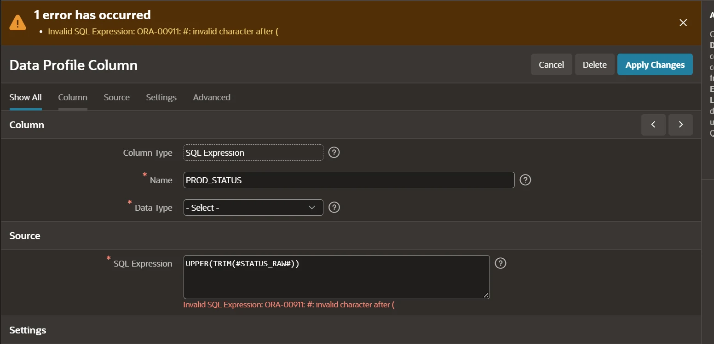<br>
  <em>Figure 17 · #STATUS_RAW# rejected when saving. ORA-00911: #: invalid character after (</em>
</p>

In my test on APEX 26.2 I could not make a SQL Expression read another column's value, so I moved the cleaning into the trigger from Test 1 — which also protects data entered through every other path. For single fixes, remember the built-in **Value Transformation** (Figure 11) — no SQL needed.

### 3. "Log into Error Log" doesn't work with Merge and a primary key

Covered in Step 4 — use **Log Error into Collection** and give the collection a name.

### 4. Dirty input can overflow a column before your trigger runs

The `ORA-12899` on `PROD_CURRENCY` appeared although the trigger would have shortened the value. Give target columns that receive messy input a little headroom and let a CHECK constraint define the valid values.

### 5. Don't trust wizard-detected types blindly

The sample file made `EAN` a Number. Barcodes, phone numbers and article codes should be text.

### 6. A failed lookup is only caught if the target column is NOT NULL

An unmatched category or supplier produces `NULL`; a `NOT NULL` column turns that into a clear rejection instead of silently wrong data.

<a id="checklist"></a>

## 14. Production Checklist

| ✔ | Practice | Why |
|---|---|---|
| 🧱 | **Load into a table with real constraints** — NOT NULL, CHECK, UNIQUE, foreign keys | Constraints are your validation layer and give precise error messages for free |
| 🔑 | **Pick a stable business key** (SKU, article number) as the primary key column | Merge decides insert-or-update from it — the wrong key duplicates or overwrites data |
| 🧹 | **Normalise messy text in the database** (trigger or package) | Trailing spaces and casing differences are guaranteed in real files |
| 🔍 | **Make lookup targets NOT NULL** when a match is mandatory | Unknown names get rejected instead of loading as NULL |
| 📋 | **Use Log Error into Collection** and show the Errors region | Users see exactly which rows failed and why |
| 🔤 | **Import identifiers as text** (EAN, phone, codes) | No lost leading zeros or scientific notation |
| 🔒 | **Restrict who can open the upload page** with an authorization scheme | An import can change many rows at once |
| 🧪 | **Test with a clean file and a deliberately broken file** | Success cases hide most of the problems |

<a id="wrap-up"></a>

## 15. Wrap-Up and What's Next

We took an everyday Excel price list and turned it into a robust import with almost no code:

- **Data Load Definition** — table target, **Merge** loading and a primary key for upsert behaviour.
- **Data Profile** — typed columns, selectors, format masks and the helper-column pattern.
- **Lookup columns** — category and supplier *names* in the file become foreign-key *IDs* in the table.
- **Error handling** — 8 broken rows rejected with exact reasons while 14 good rows loaded, and rejected rows changed nothing.
- **A small trigger** that cleans casing and whitespace for every way data reaches the table.

Try it with your own files — and break it on purpose. Upload a file with a wrong header, a duplicate SKU, an extra column. Watching APEX handle each case is the fastest way to trust the feature.

> 🚀 **Next in the series:** [**Automations**](https://apexwithhassaan.vercel.app/blog/automations-low-stock-reorder) — background jobs defined in Shared Components that run on a schedule or on demand, so routine work happens without anyone clicking a button.

---

## 📝 Changelog

See [CHANGELOG.md](CHANGELOG.md) for the version history.

---

## 📄 License

Released under the [MIT License](LICENSE) — free to use, modify and redistribute in personal and commercial projects.

---

## 🙏 Credits

Built by **Hassaan Ahmed Tahir** — Senior Oracle APEX Developer.
Special thanks to **Sajjad Hanifa** for his continued guidance and support in exploring and refining these Oracle APEX techniques.

📌 Read the original write-up on **[APEX with Hassaan](https://apexwithhassaan.vercel.app/blog/data-load-definitions)**, and keep an eye on the blog for more Oracle APEX tutorials.
